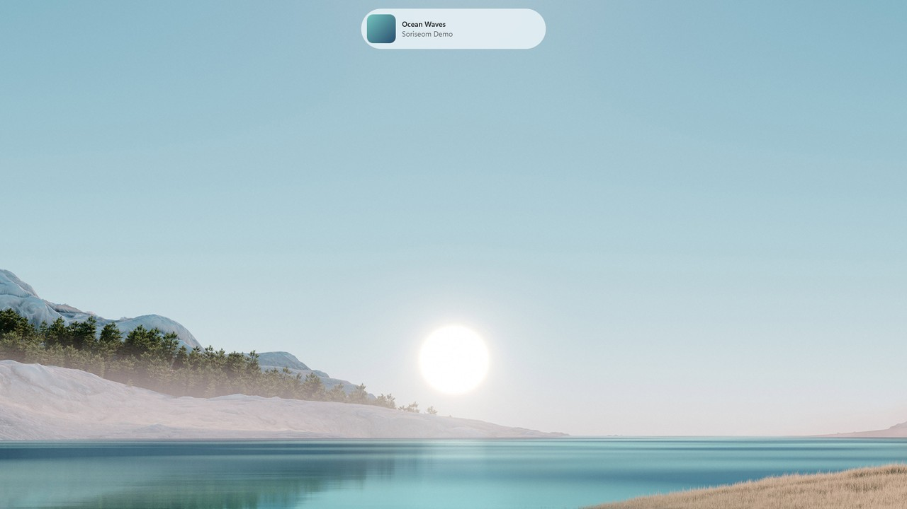

# Soriseom (소리섬)

[한국어](#한국어) | [English](#english)

## 한국어

곡이 바뀔 때 지금 재생 중인 음악을 화면에 잠깐 보여주는 Windows 앱입니다.

[Microsoft Store에서 받기](https://apps.microsoft.com/detail/9p513wzbh5t8)

### 기능

- 곡이 바뀌면 화면 위쪽 가운데(기본값)에 제목, 아티스트, 앨범아트를 몇 초간 표시
- Windows 미디어 세션(GSMTC)을 사용해 Spotify, 브라우저(YouTube, YouTube Music) 등 미디어 세션을 지원하는 앱을 플레이어 구분 없이 지원
- 팝업 위 클릭이 뒤쪽 창으로 통과되고 작업 중인 창의 포커스를 가져가지 않음
- 전체화면 앱 사용 중이나 Windows 방해 금지 중에는 표시하지 않음
- 앱별 켜기/끄기, 표시 시간, 표시 위치, 팝업 크기, 밝게·어둡게 테마 설정
- 트레이 상주, Windows 로그인 시 자동 실행
- 한국어와 영어 UI
- 사용 데이터를 수집하지 않음

### 요구 사항

- Windows 10 버전 1809 이상 또는 Windows 11

### 배포

[Microsoft Store](https://apps.microsoft.com/detail/9p513wzbh5t8)로 배포합니다.

### 기술 스택

C# / .NET 10, WinUI 3 (Windows App SDK), MSIX

### 개인정보 처리방침

[PRIVACY.md](PRIVACY.md)

### 라이선스

[MIT](LICENSE)

## English

A Windows app that briefly shows what's playing whenever the track changes.

[Get it from the Microsoft Store](https://apps.microsoft.com/detail/9p513wzbh5t8)

### Features

- Shows title, artist, and album art at the top center of the screen (by default) for a few seconds when the track changes
- Uses Windows media sessions (GSMTC), so it works with any app that reports to them, such as Spotify and browsers (YouTube, YouTube Music)
- Click-through popup that never takes focus from the window you're working in
- Stays hidden while a fullscreen app is running or Windows Do Not Disturb is on
- Per-app on/off, display duration, position, popup size, and light or dark theme settings
- Lives in the system tray and starts with Windows
- Korean and English interface
- Collects no usage data

### Requirements

- Windows 10 version 1809 or later, or Windows 11

### Distribution

Distributed through the [Microsoft Store](https://apps.microsoft.com/detail/9p513wzbh5t8).

### Tech stack

C# / .NET 10, WinUI 3 (Windows App SDK), MSIX

### Privacy

[PRIVACY.md](PRIVACY.md)

### License

[MIT](LICENSE)
